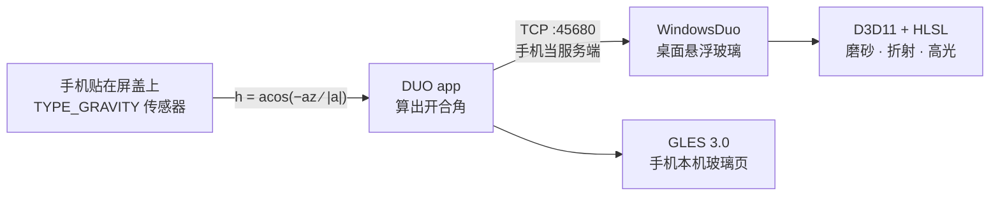

# Windows-Android-Duo

通过手机的传感器信息来同步电脑铰链的闭合角度，同时在 Android 和 Windows 上实现悬浮玻璃的效果。

**[⬇ 下载 Releases](https://github.com/thishaowang-cyber/Windows-Android-Duo/releases)** · 桌面端 zip + 手机端 APK，开箱即用


## 它是怎么连起来的



- **角度源**：`Sensor.TYPE_GRAVITY`，`h = acos(−a_z/|a|)`（0°=合盖，90°=竖直，180°=平放）。只依赖屏幕法线——手机在屏盖上转方向不改变读数，无标定、无漂移。
- **两端通信**：手机开 TCP 服务端、电脑主动连入。方向是刻意的：Windows 防火墙默认拦入站、放出站，这个方向**零防火墙规则**。手机开启共享后屏幕显示 `IP:45680`，电脑端填一次即记住。
- **玻璃几何**：保铰链的横向梯形。竖直 1:1（上下边贴屏），水平 `w = uEye / (uEye + d·sin θ)`——铰链边保持原宽、远端收窄、磨砂与变暗随收窄递增。`w ≤ 1` 恒成立，画面永不溢出屏幕。
- **`uEye` 是推导量不是滑块**：等于「观看距离 ÷ 屏幕物理高度」。手机端从 `dumpsys display` 的真实 ydpi 反推，电脑端用 `GetDeviceCaps(VERTSIZE)` 拿面板毫米数。

> 效果强度映射为 `tilt = 80° × (1 − angle/90°)`，即开合角超过 90° 后效果归零。演示时把屏盖开到 90° 以内效果最明显。

## 仓库结构

```
.
├── android/               手机端 app（Kotlin / Compose / GLES 3.0）
│   └── app/src/main/java/com/example/laptophinge/
│       ├── sensor/        角度计算（gravity / 四元数管线）
│       ├── glass/         GLES SurfaceView 渲染器
│       ├── net/           AngleServer（TCP 45680）
│       └── ui/            首页（DUO 玻璃语言）+ 效果页
├── WindowsDuo/            电脑端（C# / .NET 8 / Vortice D3D11 / WinForms）
│   ├── App/               窗口、托盘、Acrylic 背景、控件
│   ├── Core/              渲染器、捕获（DXGI/GDI）、手机角度链路
│   ├── Shaders/Glass.hlsl 全部着色器（eye-point / keystone / liquid）
│   └── msix/              稀疏包清单（WGC 实验，可选）
└── glass-shader-verify/   着色器逐像素数值验证工具（原生 WebGL，无依赖）
```

## 快速开始

### 直接用 Releases 里的成品

| 文件 | 用法 |
| --- | --- |
| `DUO-android-debug.apk` | 传到手机安装（debug 签名，提示"未知来源"时允许） |
| `WindowsDuo-win-x64.zip` | **整包解压**后运行 `WindowsDuo\WindowsDuo.exe`（需 [.NET 8 Desktop Runtime](https://dotnet.microsoft.com/download/dotnet/8.0)）。exe 未做代码签名：首次启动如遇 SmartScreen 蓝屏，点"更多信息 → 仍要运行"即可 |

使用顺序：手机打开 DUO → 开启「发送角度到电脑」→ 把屏幕上的 `IP:45680` 填进电脑端 → 开合屏盖看效果。两端需在同一局域网。

### 从源码构建

**手机端**（需 JDK 21 + Android SDK；AGP 8.13.2 / Kotlin 2.2.20 / Gradle 8.14.4）

```bash
cd android
./gradlew :app:assembleDebug       # 产物在 app/build/outputs/apk/debug/
./gradlew :app:testDebugUnitTest   # assembleDebug 不编译测试源码，需单独跑
```

**电脑端**（需 .NET 8 SDK + WindowsDesktop 运行时）

```bash
cd WindowsDuo
dotnet build -c Release
```

**验证渲染正确性**（无头运行，不开窗口）

```bash
dotnet bin/Release/net8.0-windows10.0.22621.0/WindowsDuo.dll --verify
```

① 几何探针：像素着色器输出投影点，纯 C# oracle 重算同一公式逐像素比对（最大差异 ~5e-7，浮点级）；② 在 0/20/40/60/80° 渲染 PNG 到 `verify-out/`。

**着色器数值验证工具**（对照独立参考实现，逐像素）

```bash
cd glass-shader-verify
python3 serve.py        # 或 node serve.mjs，浏览器打开即可
```

## 常见问题

- **电脑端双击 exe 被拦**：未签名 exe 在开启 Smart App Control 的 Win11（24H2 全新安装的默认状态）会被直接拦截且无法绕过。这不是应用问题——用源码自行 `dotnet build`，本地构建的 exe 不受此限。
- **看不到效果**：确认手机与电脑同网段、防火墙未把已建立连接的返回流量拦掉；角度 > 90° 时效果按设计归零（见上文提示）。
- **桌面捕获帧率低**：部分机器上 DXGI Desktop Duplication 返回全黑帧（安全软件 hook 所致），应用会自动回退 GDI BitBlt（约 35–39 fps）。

## License

[MIT](LICENSE)
